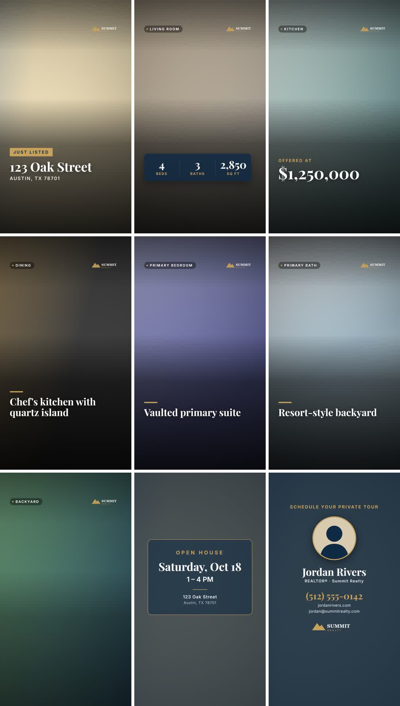
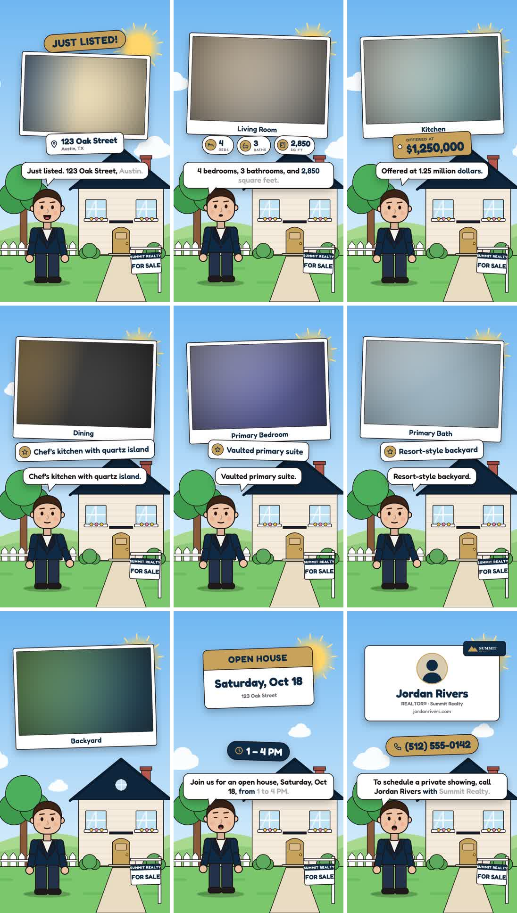

# Listing Video

Local real estate video generator. A listing folder goes in and a 1080×1920 MP4 for Reels, TikTok or Shorts comes out.
It uses no AI, no cloud and no API keys: everything runs on this PC with Remotion and ffmpeg.

## Examples

Rendered from `listings/example` (placeholder photos):

| Photo style | Character style |
|---|---|
|  |  |
| [just-listed-photo.mp4](examples/just-listed-photo.mp4) | [just-listed-character.mp4](examples/just-listed-character.mp4) |

## Quick start

```bash
npm install
npm run setup                           # one-time: Piper voice engine + 2 voices (~140 MB, offline after)
npm run sample                          # placeholder photos + music in listings/example
npm run make -- listings/example        # -> out/example.mp4, .cover.jpg, .sheet.jpg
npm run make -- listings/example --check  # cover + 3x3 preview sheet only (fast)
npm run studio                          # Remotion Studio, live preview with sample data
```

The first render downloads Remotion's headless Chrome (~113 MB), one time only.

## Two styles

```bash
npm run make -- listings/example                      # photo style: full-screen listing photos
npm run make -- listings/example --style character    # cartoon realtor presents in front of a house
npm run make -- listings/example --style character --backdrop photo   # ...in front of the listing's own front photo
```

Or set `"style": "character"` / `"backdrop": "photo"` in listing.json.
In the character style, the agent waves, talks with lip-sync, and points up as cards pop in above (room photos, bed/bath/sqft chips, price tag, features, open-house calendar, contact card).
Speech-bubble captions highlight each word as it's spoken. Pick the character in brand.json with
`"character": "sofia"` (presets: james, sofia, marcus, emily, david, aisha, grace) or customise it:
`{ "preset": "emily", "hair": { "color": "#3B2416" }, "top": "polo" }`. The blazer takes the brand's primary colour.

## Voice

Narration is generated offline by [Piper](https://github.com/rhasspy/piper). Each scene's line is
built from the listing data (override any with `lines` in listing.json), and scenes are timed to fit
what's said. The character's mouth follows the loudness of the voice, and the music dips under it.

- `brand.json` → `"voice": "auto"` (matches the character: male or female), `"male"`, `"female"`;
  `"voiceSpeed": 0.95` (lower = faster)
- `--no-voice` or `"voice": false` in listing.json renders without narration

## A listing

```
listings/123-oak-st/
  listing.json
  photos/        01-exterior.jpg, 02-kitchen.jpg …  (filename order = video order,
                 filename = room label: "05-primary-bedroom.jpg" -> "Primary Bedroom")
  music.mp3      optional
```

```json
{
  "template": "just-listed",
  "address": { "street": "123 Oak Street", "city": "Austin", "state": "TX", "zip": "78701" },
  "price": 1250000,
  "beds": 4, "baths": 3, "sqft": 2850,
  "features": ["Chef's kitchen", "Resort-style backyard"],
  "openHouse": { "date": "Saturday, Oct 18", "time": "1 – 4 PM" },
  "music": "music.mp3"
}
```

| Field | Notes |
|---|---|
| `template` | `property-tour`, `just-listed`, `open-house`, `just-sold`, `price-reduced`, `agent-intro` |
| `previousPrice` | required for `price-reduced` (shows the old price struck through) |
| `openHouse` | required for `open-house`; adds an open-house card to any template |
| `points` | `agent-intro` only: one selling point per scene |
| `headline` | overrides the badge text, e.g. `"COMING SOON"` |
| `photos` | optional explicit order/labels: `["a.jpg", {"file": "b.jpg", "label": "Wine Cellar"}]` |
| `brand` | path to a different `brand.json` (default `brand/brand.json`) |
| `lines` | narration overrides by scene: `intro`, `stats`, `price`, `openhouse`, `outro` |

## Brand kit (`brand/brand.json`)

This holds the agent's name, title, brokerage, phone, email, website, logo, headshot, `colors.primary` and `colors.accent`.
It also sets `transition` (`push` | `fade`), `sfx` (transition whooshes on/off) and a default `music` track.
Image paths are relative to the brand.json file.
Make one brand folder per client and point a listing at it with `"brand": "../../brands/acme/brand.json"`.

## How it's built

- `src/schema.ts`: zod schemas for listing.json and brand.json
- `src/timeline.ts`: turns the listing data into scenes with timings and narration lines (pure; shared by the render and the CLI)
- `src/video/`: Remotion components (Ken Burns photos, cards, intro, open house, agent outro)
- `tools/make.mjs`: validates, resizes photos (cached), bundles, renders, mixes the audio
- `tools/audio.mjs`: music bed, synthesised whooshes, voice ducking (ready for Piper)

## Roadmap

- [x] Pipeline, 6 templates, brand kit, music, SFX, cover, preview sheet
- [x] Character style (vector figure, lip-sync, gestures)
- [x] Piper offline voiceover, energy-driven lip-sync
- [ ] Local web UI: fill in a listing, drop photos, render
